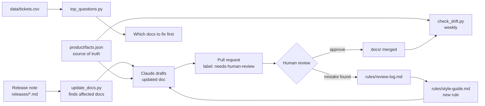

# release-to-docs

**Release notes in, reviewed documentation out.**
A small, working pipeline that keeps product help docs in step with a fast release cadence: Claude drafts the updates, a person reviews every change, and every mistake found in review becomes a rule the next draft follows.

> This is a demo project. The product ("Ringo", a cloud phone system), its docs and the support data are fictional, made up to show the approach end to end.

## The problem

A team that ships 100+ releases a quarter can't keep docs, in-app tours and AI help answers current by hand. Docs drift, customers open "how do I…" tickets, and the AI assistant answers from outdated facts.

## How it works



The pipeline covers three jobs:

| Job | Script | What "done" looks like |
|---|---|---|
| **Keep up with releases** | `scripts/update_docs.py` + GitHub Action | Every release note opens a PR with drafted doc updates within minutes. Docs current within a week, without anyone having to ask. |
| **Catch drift** | `scripts/check_drift.py` (weekly + on every PR) | Renamed UI labels, removed features and docs older than the last release that touched them are flagged automatically. |
| **Fix what matters most** | `scripts/top_questions.py` | A ranked list of the topics customers ask about most, mapped to the doc that should answer them. |

## Human in the loop, by design

AI writes the first draft. A person decides what ships.

1. Every drafted change arrives as a pull request labelled `needs-human-review`. Nothing merges without approval.
2. The PR template is a review checklist: facts match the product, steps work in the live product, screenshots current, tone follows the style guide.
3. When a reviewer finds a mistake, it goes into [`rules/review-log.md`](rules/review-log.md) and, if it can happen again, becomes a rule in [`rules/style-guide.md`](rules/style-guide.md). The next draft follows it. Quality goes up over time instead of depending on who reviewed.
4. Product facts (UI labels, limits, plan availability) live in one file, [`product/facts.json`](product/facts.json). The drafts, the drift check and any AI help assistant all read the same facts, so they give the same answer a good support agent would.

## Repository layout

```
releases/              release notes, one file per release (frontmatter lists affected features)
docs/                  help articles in Markdown (frontmatter: features, last_release, last_reviewed)
product/facts.json     single source of truth for UI labels, renames and limits
rules/style-guide.md   how we write (fed to Claude with every draft)
rules/review-log.md    mistakes found in review and the rule each one produced
data/tickets.csv       sample support tickets tagged by topic
scripts/               update_docs.py, check_drift.py, top_questions.py
.github/               the release → PR workflow, the weekly drift check, the review checklist
```

## Quick start

```bash
pip install -r requirements.txt

# 1. See what Claude would be asked, without calling the API
python scripts/update_docs.py releases/2026-11-04-v4.12.md --dry-run

# 2. Draft the updates for real (needs ANTHROPIC_API_KEY or an `ant auth login` profile)
python scripts/update_docs.py releases/2026-11-04-v4.12.md

# 3. Check docs against the product facts
python scripts/check_drift.py

# 4. Rank the most-asked topics
python scripts/top_questions.py
```

In GitHub, add an `ANTHROPIC_API_KEY` repository secret. Pushing a new file to `releases/` then opens a pull request with the drafted updates.

## Measuring it

- **Freshness:** days between a release and the merged doc update (target: under 7).
- **Drift:** open issues from the weekly drift check (target: zero at the end of each week).
- **Review quality:** share of drafts merged without edits, and how often the same mistake comes back (it shouldn't, once it's a rule).
- **Impact:** "how do I" tickets per topic before and after the doc was fixed.

## What's next

- Compare screenshots and in-app tours against the live product (visual diff).
- Publish to a docs platform such as Mintlify, and keep in-app guidance (e.g. Appcues) in sync from the same source.
- Feed search queries and "no answer found" logs from the help center into `top_questions.py`.

---

Built by Simona Křístková as a portfolio project: [portfolio](https://claude.ai/artifact/4YZoLNZWNtZoVvCeST7poT).
